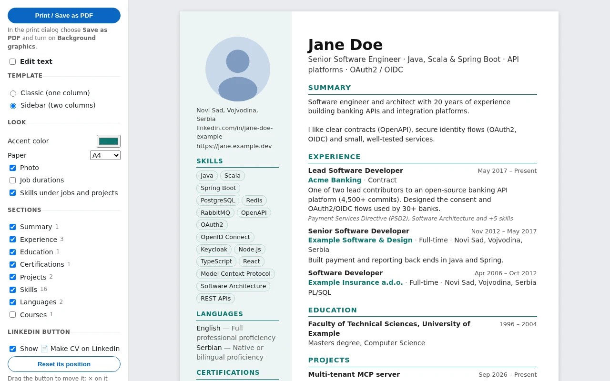
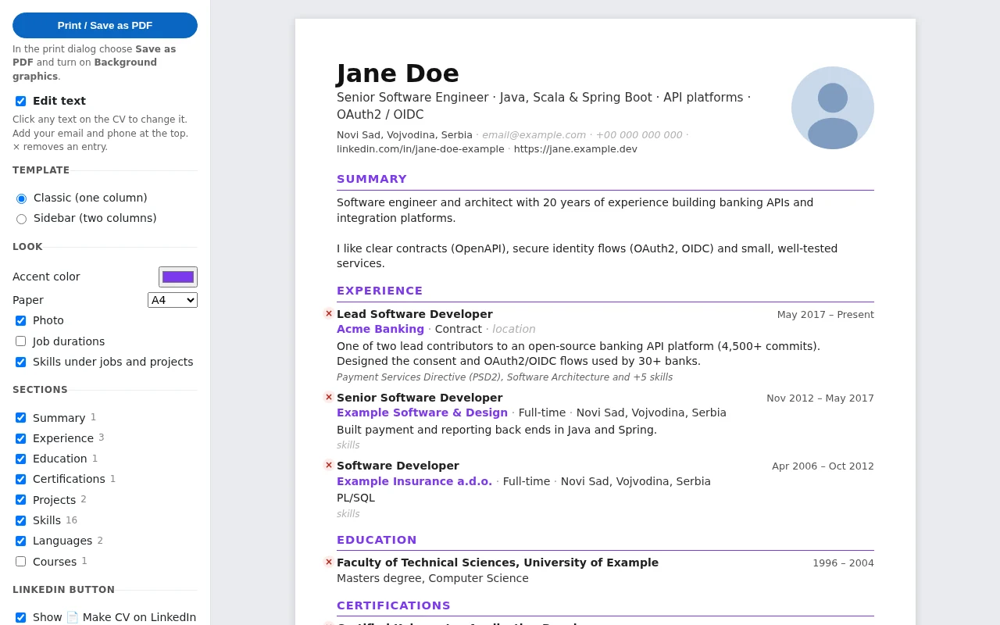

Most people keep two versions of their working life. One is the LinkedIn profile, updated when something changes. The other is a CV in a Word file, updated when they need to send it. **Sooner or later the two disagree**, and the person who notices is usually the one deciding whether to call you.

In short

<strong>Treat your LinkedIn profile as the single source of truth and make the CV from it, instead of maintaining both. I built a free Chrome extension, <a href="https://constantine2nd.github.io/resume-maker-for-linkedin/">Resume Maker for LinkedIn</a>, that turns the profile into a printable CV in one click, and does it entirely in your browser.</strong>

<ul class="post-facts">
<li>servers involved: <b>0</b></li>
<li>accounts needed: <b>0</b></li>
<li>permissions: <b>storage</b> only</li>
<li>source code: <b>open, MIT</b></li>
</ul>

## Why two copies drift apart

Recruiters and hiring managers look you up. Often they open the profile before the interview, sometimes before they open the CV. When the two tell different stories, an old job title, a project missing from one of them, dates that do not line up, the reader has to decide which version is true. Neither answer helps you.

The drift is not dishonesty. It is the ordinary problem of keeping two copies of the same data in sync by hand. Engineers have a name for the fix: pick one **source of truth** and derive everything else from it. Your profile is already the copy people check, it is the one you update anyway, so it is the natural source. The CV becomes a view of it, regenerated whenever you need one.

## What the extension does

1. Open your own LinkedIn profile and click **📄 Make CV** (bottom right of the page).
2. The CV opens in a new tab. Pick a template, *Classic* (one column) or *Sidebar* (two columns), an accent color and the paper size. Switch sections on or off.
3. Fix any text in place: shorten a description, remove an entry, add your email and phone, which are not on the profile.
4. Click **Print / Save as PDF**.

<figure>

<figcaption>A CV made from a sample profile, <i>Sidebar</i> template.</figcaption>
</figure>

Your edits are kept. When you change the profile and make the CV again, the extension asks whether to keep your edits or start from the new LinkedIn data, so a tweak you made for one application is not silently lost.

<figure>

<figcaption><i>Edit text</i> on: change any line before printing.</figcaption>
</figure>

## Under the hood

A tool that reads your profile should be easy to trust, so the design keeps everything on your machine and asks for as little as possible.

**It reads the page you are already looking at.** The extension is a Manifest V3 content script on `linkedin.com`. It does nothing until you click the button. Then it reads the profile from the page itself, the same text you see, and turns it into plain JSON. It does not call LinkedIn's API and does not use your session for anything else.

**It loads the full lists the way you would.** A profile page shows only the first few skills, projects or certifications, with a *Show all* link. The extension opens each of those *Show all* pages in a hidden frame on the same site, scrolls it until every item is loaded, reads the items and removes the frame. That is why the button shows progress for a few seconds.

**The CV is an ordinary HTML page inside the extension.** The extracted JSON goes to `chrome.storage.local`, on your computer. The CV page reads it from there, renders it with one of two print stylesheets, and the browser's own print dialog makes the PDF. There is no server: no upload, no account, no analytics, nothing to breach.

**It asks for one permission.** The manifest requests only `storage`. The content script runs only on `linkedin.com`, and the extension ships no remote code; everything it runs is in the package the Chrome Web Store reviewed.

The parsing is plain functions, separate from the browser code, with unit tests against a made-up profile, so a change in the CV layout can be tested without logging in anywhere.

## Limits

- **It depends on LinkedIn's page layout.** The extension reads the page, so when LinkedIn redesigns its profile pages, extraction can break until the extension is updated. If something comes out missing or wrong, [open an issue](https://github.com/constantine2nd/resume-maker-for-linkedin/issues).
- **Contact details are not on the profile.** Add your email and phone in the CV before printing; they are kept for next time.
- **It is for your own profile.** It makes a CV from the profile you are viewing, for you to print.
- **It is not affiliated with, endorsed or sponsored by LinkedIn.**

## Get it

- [Install from the Chrome Web Store](https://chromewebstore.google.com/detail/resume-maker-for-linkedin/bljdjefikplnmpfoophclaabmigoldof) (free)
- [Project page](https://constantine2nd.github.io/resume-maker-for-linkedin/) and [privacy policy](https://constantine2nd.github.io/resume-maker-for-linkedin/privacy.html)
- [Source code on GitHub](https://github.com/constantine2nd/resume-maker-for-linkedin) (MIT)

Update the profile, then make the CV. One copy to maintain, and nobody has to wonder which one is true.
